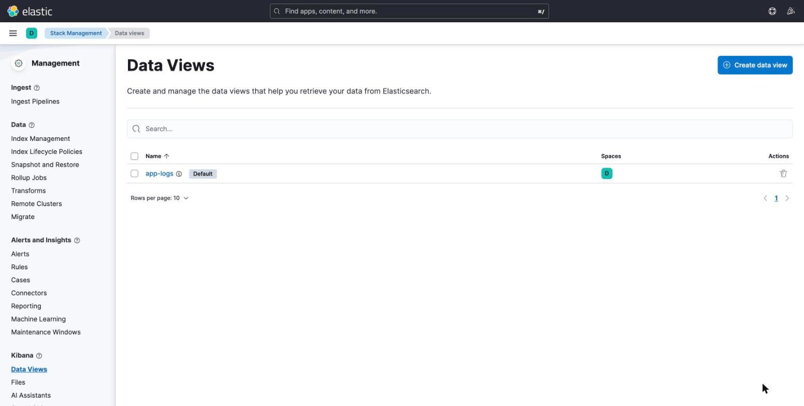
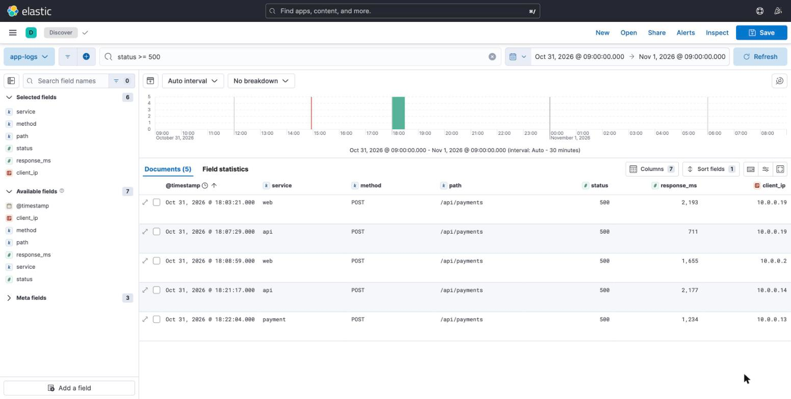

# 07-elk

Docker Compose 로 Elasticsearch + Kibana 를 로컬에 띄우고, 샘플 로그를 직접 넣은(Bulk) 뒤 조회(Query DSL / Kibana)한다.

> 로컬 실습용 단일 노드 + 보안 비활성화(`xpack.security.enabled=false`) 구성이다. 운영에서는 사용하지 않는다.

## 전체 흐름

```
logs.ndjson ──(curl _bulk)──▶ Elasticsearch (app-logs 인덱스) ◀── Kibana (Discover / KQL)
                                      ▲
                               curl _search (Query DSL)
```

## 1. 실행

```bash
docker compose up -d
docker compose ps          # elasticsearch 가 healthy 가 될 때까지 대기

curl -s localhost:9200     # 버전 확인 (8.14.3)
```

- Elasticsearch: http://localhost:9200
- Kibana: http://localhost:5601  (기동에 1~2분 소요)

## 2. 인덱스 생성 (매핑 정의)

자동 매핑에 맡기지 않고 필드 타입을 명시한다. 문자열 필터/집계용 필드는 `keyword`, 시간은 `date`.

```bash
curl -s -XPUT localhost:9200/app-logs -H 'Content-Type: application/json' -d '{
  "mappings": {"properties": {
    "@timestamp":  {"type": "date"},
    "service":     {"type": "keyword"},
    "method":      {"type": "keyword"},
    "path":        {"type": "keyword"},
    "status":      {"type": "integer"},
    "response_ms": {"type": "integer"},
    "client_ip":   {"type": "ip"}
  }}}'
```

## 3. 데이터 삽입 (Bulk API)

`data/logs.ndjson` 에 웹 접근 로그 60건이 들어 있다 (2026-10-31 09:00 ~ 09:47 UTC, 서비스 `web` / `api` / `payment`).
Bulk API 는 `{"index":{}}` 액션 줄과 문서 줄이 번갈아 나오는 NDJSON 형식이다.

```bash
curl -s -XPOST 'localhost:9200/app-logs/_bulk?refresh=true' \
  -H 'Content-Type: application/x-ndjson' \
  --data-binary @data/logs.ndjson | python3 -c 'import sys,json;d=json.load(sys.stdin);print("errors:",d["errors"])'

curl -s 'localhost:9200/app-logs/_count?pretty'   # count: 60
```

문서 한 건만 넣을 때:

```bash
curl -s -XPOST localhost:9200/app-logs/_doc -H 'Content-Type: application/json' -d '{
  "@timestamp": "2026-10-31T10:00:00Z", "service": "api", "method": "GET",
  "path": "/api/users", "status": 200, "response_ms": 33, "client_ip": "10.0.0.1"}'
```

## 4. 조회 (Query DSL)

```bash
# (1) 500 에러 로그, 오래된 순
curl -s 'localhost:9200/app-logs/_search?pretty' -H 'Content-Type: application/json' -d '{
  "query": {"range": {"status": {"gte": 500}}},
  "sort": [{"@timestamp": "asc"}]}'

# (2) payment 서비스의 5xx  (bool + filter)
curl -s 'localhost:9200/app-logs/_search?pretty' -H 'Content-Type: application/json' -d '{
  "query": {"bool": {"filter": [
    {"term":  {"service": "payment"}},
    {"range": {"status": {"gte": 500}}}]}}}'

# (3) 상태 코드별 건수 + 평균 응답시간 (집계)
curl -s 'localhost:9200/app-logs/_search?pretty' -H 'Content-Type: application/json' -d '{
  "size": 0,
  "aggs": {
    "by_status": {"terms": {"field": "status"}},
    "avg_ms":    {"avg":   {"field": "response_ms"}}}}'
```

실행 결과 (이 데이터 기준): 500 → 5건, `payment` 의 5xx → 1건, 상태 코드 분포 200:34 / 201:7 / 401:7 / 404:7 / 500:5, 평균 응답시간 ≈ 298ms.

## 5. Kibana 에서 조회



1. Stack Management → Data Views → **Create data view**
   - Name / Index pattern: `app-logs`, Timestamp field: `@timestamp`
2. Discover 에서 시간 범위를 **2026-10-31 00:00 ~ 23:59** 로 지정 (샘플 데이터 시각 기준. 기본 15분이면 아무것도 안 보인다).
3. KQL 검색 예시
   ```
   status >= 500
   service : "payment" and status >= 500
   path : "/login" and status : 401
   response_ms > 1000
   ```



> Kibana 는 브라우저 시간대로 표시한다. 데이터는 UTC 09:00 기준이라 KST 에서는 18:00 대로 보인다.

## 정리

```bash
docker compose down -v     # 컨테이너 + 볼륨(인덱스 데이터) 삭제
```

## 트러블슈팅
- Elasticsearch 가 바로 종료되면 Docker Desktop 메모리를 4GB 이상으로 올린다.
- Kibana 가 `503` / `Kibana server is not ready yet` 이면 1~2분 더 기다린다.
