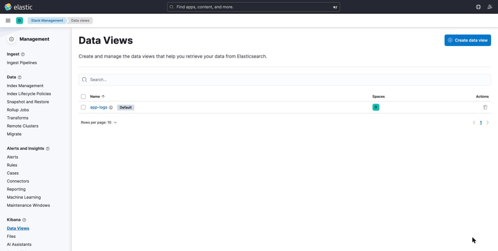
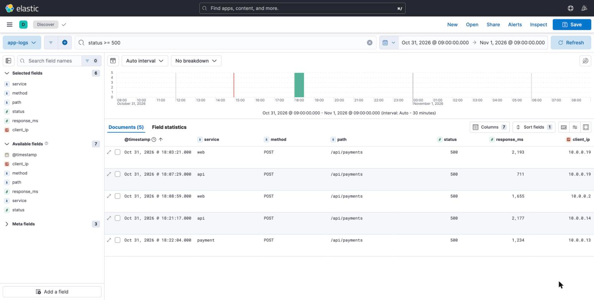

# [ELK] Docker Compose로 Elasticsearch·Kibana 띄우고 로그 넣어서 조회하기

Prometheus 글에서는 메트릭을 수집해 PromQL로 조회했다. 이번에는 관측성의 또 다른 축인 **로그**를 다룬다. ELK 스택이 무엇이고 왜 쓰는지 짚어본 뒤, 로컬에서 Elasticsearch와 Kibana를 직접 띄워 샘플 로그를 넣고 조회하는 데모까지 해본다.

실습 코드: https://github.com/nasonyo/blog-labs/tree/main/07-elk

---

## 1. 왜 ELK 인가

서비스가 하나일 때는 서버에 접속해서 `tail -f` 와 `grep` 으로 로그를 본다. 서버가 여러 대가 되고 컨테이너가 수시로 뜨고 사라지면 이 방식은 금방 한계에 부딪힌다.

- 로그가 여러 서버·컨테이너에 흩어져 있어서 한 요청의 흐름을 따라가기 어렵다.
- 컨테이너가 사라지면 로그도 같이 사라진다.
- 텍스트 `grep` 으로는 "최근 1시간 동안 payment 서비스의 5xx 건수" 같은 집계를 하기 어렵다.

그래서 로그를 **한곳에 모으고 → 검색 가능한 형태로 저장하고 → 화면으로 조회**하는 구조가 필요하다. ELK 는 이 구조를 구성하는 대표적인 오픈소스 조합이다. 주로 다음 목적으로 쓴다.

| 목적 | 예시 |
|---|---|
| 중앙 집중 로그 검색 | 여러 서버의 애플리케이션 로그를 한 화면에서 검색 |
| 장애 분석 | 에러가 발생한 시점 전후의 로그를 시간대·서비스별로 좁혀 보기 |
| 집계·통계 | 상태 코드별 건수, 엔드포인트별 평균 응답시간 |
| 보안·감사 | 로그인 실패 급증 같은 이상 징후 탐지 |

참고로 Prometheus 는 "숫자로 된 시계열 메트릭"을, ELK 는 "이벤트 단위의 텍스트·JSON 로그"를 다룬다. 서로 대체재가 아니라 보완 관계라서 둘을 같이 쓰는 경우가 많다.

## 2. 구성 요소와 역할

ELK 는 세 제품의 앞글자다. 여기에 수집기인 Beats 가 더해져 지금은 **Elastic Stack** 이라고도 부른다.

```
[앱/서버 로그] → Beats(Filebeat) → Logstash → Elasticsearch → Kibana
                  수집·전송        가공·변환     저장·검색       시각화·조회
```

- **Elasticsearch** — 저장과 검색을 담당하는 분산 검색 엔진이다. 데이터를 JSON 문서로 저장하고, 필드를 색인(인덱싱)해서 빠르게 검색·집계한다. REST API 로 모든 작업을 한다. 이번 데모의 핵심 컴포넌트다.
- **Kibana** — Elasticsearch 위에 올라가는 웹 UI 다. Discover 에서 로그를 검색하고, 차트와 대시보드를 만들 수 있다.
- **Logstash** — 수집한 데이터를 파싱·변환·필터링해서 Elasticsearch 로 보내는 파이프라인이다. 로그 한 줄을 필드별로 쪼개거나 IP 에서 위치를 붙이는 일을 한다.
- **Beats (Filebeat 등)** — 서버에 설치하는 가벼운 수집 에이전트다. Filebeat 는 로그 파일을 읽어서 Logstash 또는 Elasticsearch 로 보낸다.

실무에서는 보통 `Filebeat → (Logstash) → Elasticsearch → Kibana` 로 구성한다. 변환이 필요 없으면 Logstash 를 생략하기도 한다.

## 3. 이번 데모의 범위

수집 에이전트(Beats)와 Logstash 까지 넣으면 구성이 커져서 ELK 의 핵심 흐름이 가려진다. 이번에는 **Elasticsearch 와 Kibana 만** 띄우고, 수집 단계는 직접 API 로 대신한다.

```
logs.ndjson ──(curl _bulk)──▶ Elasticsearch (app-logs 인덱스) ◀── Kibana (Discover / KQL)
                                      ▲
                               curl _search (Query DSL)
```

1. Docker Compose 로 Elasticsearch, Kibana 실행
2. 필드 타입을 지정해 인덱스 생성
3. Bulk API 로 샘플 로그 60건 삽입
4. Query DSL 로 조회
5. Kibana 에서 Data View 를 만들고 KQL 로 조회

> **주의**: 이 구성은 로컬 실습용이다. 단일 노드이고 보안(`xpack.security.enabled=false`)을 꺼두었다. 운영 환경에서는 그대로 쓰면 안 된다.

## 4. 실행

### compose.yaml

```yaml
services:
  elasticsearch:
    image: docker.elastic.co/elasticsearch/elasticsearch:8.14.3
    container_name: elasticsearch
    environment:
      - discovery.type=single-node          # 로컬 실습용 단일 노드
      - xpack.security.enabled=false        # 실습 편의를 위해 보안 비활성화 (운영 금지)
      - ES_JAVA_OPTS=-Xms512m -Xmx512m      # 힙 메모리 제한
    ports:
      - "9200:9200"
    volumes:
      - es-data:/usr/share/elasticsearch/data
    healthcheck:
      test: ["CMD-SHELL", "curl -s localhost:9200/_cluster/health | grep -qE '\"status\":\"(green|yellow)\"'"]
      interval: 10s
      timeout: 5s
      retries: 20

  kibana:
    image: docker.elastic.co/kibana/kibana:8.14.3
    container_name: kibana
    environment:
      - ELASTICSEARCH_HOSTS=http://elasticsearch:9200
    ports:
      - "5601:5601"
    depends_on:
      elasticsearch:
        condition: service_healthy

volumes:
  es-data:
```

- Elasticsearch 는 메모리를 많이 쓰기 때문에 힙을 512MB 로 제한했다.
- healthcheck 를 걸고 `depends_on` 에 `service_healthy` 조건을 줘서, Elasticsearch 가 준비된 뒤에 Kibana 가 뜨게 했다.
- 이미지 태그는 `latest` 대신 버전을 고정했다.

```bash
docker compose up -d
docker compose ps          # elasticsearch 가 healthy 가 될 때까지 대기

curl -s localhost:9200     # 버전 확인 (8.14.3)
```

Elasticsearch 는 http://localhost:9200, Kibana 는 http://localhost:5601 이다. Kibana 는 기동에 1~2분 걸린다.

## 5. 인덱스 생성 (매핑 정의)

Elasticsearch 는 필드 타입을 자동으로 추론해 주지만, 로그 용도라면 직접 지정하는 편이 안전하다. 특히 문자열 필드는 정확히 일치시켜 필터·집계할 값이면 `keyword` 로 둔다.

```bash
curl -s -XPUT localhost:9200/app-logs -H 'Content-Type: application/json' -d '{
  "mappings": {"properties": {
    "@timestamp":  {"type": "date"},
    "service":     {"type": "keyword"},
    "method":      {"type": "keyword"},
    "path":        {"type": "keyword"},
    "status":      {"type": "integer"},
    "response_ms": {"type": "integer"},
    "client_ip":   {"type": "ip"}
  }}}'
```

## 6. 데이터 삽입 (Bulk API)

샘플은 웹 접근 로그 60건이다. 서비스는 `web`, `api`, `payment` 이고, 시각은 2026-10-31 09:00~09:47 UTC 이다. 상태 코드는 200, 201, 401, 404, 500 이 섞여 있다.

Bulk API 는 **액션 줄과 문서 줄이 번갈아 나오는 NDJSON** 형식이다.

```json
{"index": {}}
{"@timestamp": "2026-10-31T09:00:30Z", "service": "api", "method": "GET", "path": "/login", "status": 401, "response_ms": 207, "client_ip": "10.0.0.2"}
```

```bash
curl -s -XPOST 'localhost:9200/app-logs/_bulk?refresh=true' \
  -H 'Content-Type: application/x-ndjson' \
  --data-binary @data/logs.ndjson | python3 -c 'import sys,json;d=json.load(sys.stdin);print("errors:",d["errors"])'
# errors: False

curl -s 'localhost:9200/app-logs/_count?pretty'   # count: 60
```

`refresh=true` 는 삽입 직후 바로 검색되도록 하는 옵션이다. 로컬 실습에서는 편하지만, 운영에서 대량 삽입할 때는 쓰지 않는 게 좋다.

## 7. 조회 (Query DSL)

Elasticsearch 는 JSON 으로 쿼리를 작성하는 Query DSL 을 쓴다.

**(1) 500 에러 로그를 오래된 순으로**

```bash
curl -s 'localhost:9200/app-logs/_search?pretty' -H 'Content-Type: application/json' -d '{
  "query": {"range": {"status": {"gte": 500}}},
  "sort": [{"@timestamp": "asc"}]}'
```

**(2) payment 서비스의 5xx — bool + filter**

```bash
curl -s 'localhost:9200/app-logs/_search?pretty' -H 'Content-Type: application/json' -d '{
  "query": {"bool": {"filter": [
    {"term":  {"service": "payment"}},
    {"range": {"status": {"gte": 500}}}]}}}'
```

**(3) 상태 코드별 건수와 평균 응답시간 — 집계**

```bash
curl -s 'localhost:9200/app-logs/_search?pretty' -H 'Content-Type: application/json' -d '{
  "size": 0,
  "aggs": {
    "by_status": {"terms": {"field": "status"}},
    "avg_ms":    {"avg":   {"field": "response_ms"}}}}'
```

실행 결과는 다음과 같다.

| 조회 | 결과 |
|---|---|
| 500 에러 | 5건 |
| payment 서비스의 5xx | 1건 |
| 상태 코드 분포 | 200: 34 / 201: 7 / 401: 7 / 404: 7 / 500: 5 |
| 평균 응답시간 | 약 298ms |

`"size": 0` 은 문서 본문은 받지 않고 집계 결과만 받겠다는 뜻이다.

## 8. Kibana 에서 조회

### Data View 만들기

Kibana 에서 로그를 보려면 먼저 Data View 를 만들어야 한다. 어떤 인덱스를 어떤 시간 필드 기준으로 볼지 정의하는 것이다.

UI 에서는 Stack Management → Data Views → Create data view 로 만든다.

- Name / Index pattern: `app-logs`
- Timestamp field: `@timestamp`

API 로도 만들 수 있다.

```bash
curl -s -XPOST localhost:5601/api/data_views/data_view \
  -H 'kbn-xsrf: true' -H 'Content-Type: application/json' \
  -d '{"data_view":{"id":"app-logs","title":"app-logs","name":"app-logs","timeFieldName":"@timestamp"}}'
```



### Discover 에서 KQL 로 검색

Discover 에서 시간 범위를 **2026-10-31 하루**로 지정한다. 기본값인 최근 15분으로 두면 샘플 데이터가 범위 밖이라 아무것도 안 보인다.

```
status >= 500
service : "payment" and status >= 500
path : "/login" and status : 401
response_ms > 1000
```

`status >= 500` 으로 검색한 결과다. Query DSL 로 조회했을 때와 같은 5건이 나온다.



> Kibana 는 브라우저 시간대로 시각을 표시한다. 데이터는 UTC 09:00 기준인데 KST 환경에서는 18:00 대로 보인다.

## 9. 정리

```bash
docker compose down -v     # 컨테이너 + 볼륨(인덱스 데이터) 삭제
```

## 10. 트러블슈팅

- Elasticsearch 가 바로 종료되면 Docker Desktop 메모리를 4GB 이상으로 올린다.
- Kibana 가 `503` 또는 `Kibana server is not ready yet` 이면 1~2분 더 기다린다.
- Discover 에 데이터가 안 보이면 시간 범위부터 확인한다.

## 마무리

Elasticsearch 에 로그를 넣고 Query DSL 과 Kibana 두 가지 방식으로 조회해 봤다. 같은 데이터를 REST API 로도, UI 로도 볼 수 있다는 점이 ELK 의 기본 구조다.

이번에는 수집 단계를 `curl` 로 대신했다. 다음에는 Filebeat 로 컨테이너 로그를 자동 수집하는 구성으로 확장해 볼 수 있다.
